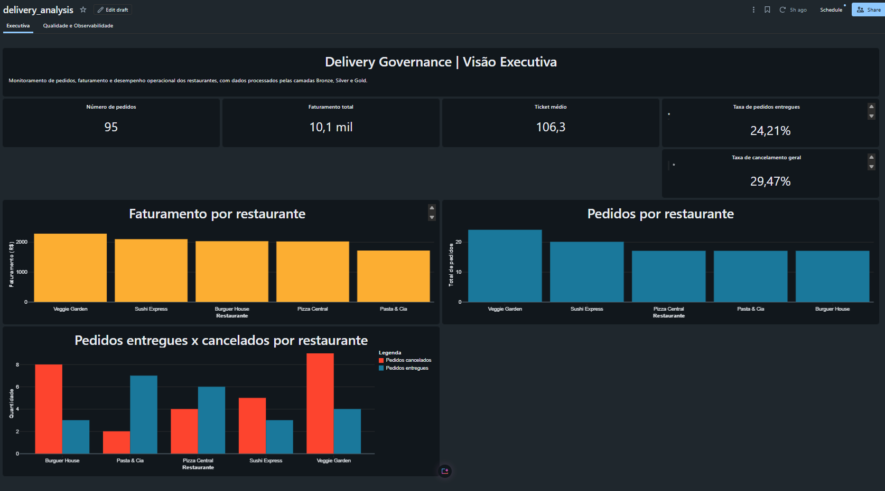
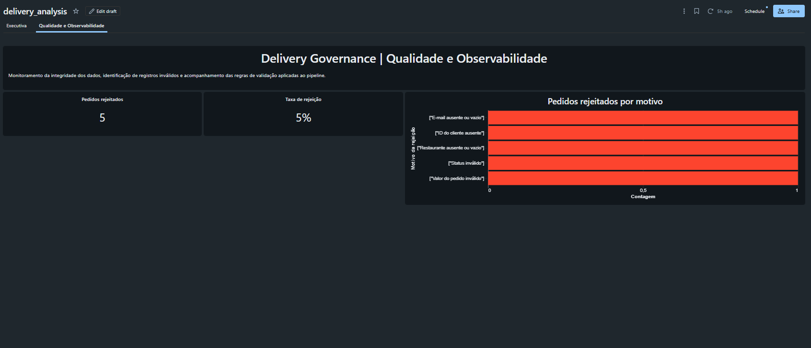
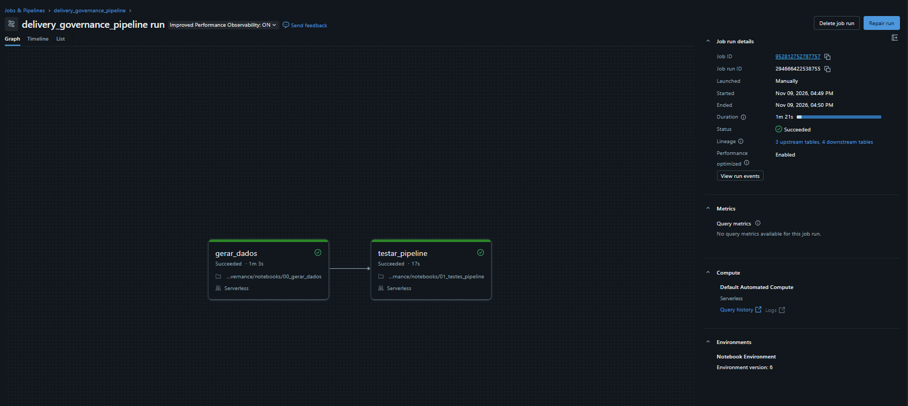
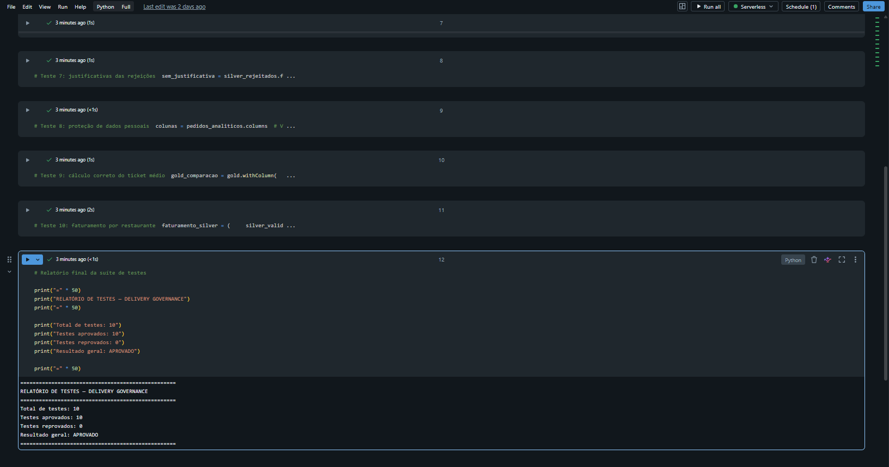

# Delivery Governance
### End-to-End Data Engineering, Quality and Governance with Databricks

An end-to-end data engineering project that simulates a food delivery operation, demonstrating how data pipelines, quality controls, governance policies and analytical dashboards can work together to support reliable business decisions.

## Project Overview

The project implements a data pipeline using Databricks, following the Medallion Architecture to organize data into Bronze, Silver and Gold layers.

It processes synthetic food delivery orders, identifies data quality issues, separates valid and rejected records, generates analytical indicators and provides monitoring dashboards.

The pipeline also includes automated validation tests, workflow orchestration and access governance through Unity Catalog.

For a detailed explanation of the implementation, see the [Technical Architecture Documentation](docs/architecture.md).

## Architecture

The solution follows three data processing layers:

| Layer | Purpose | Main Components |
|---|---|---|
| Bronze | Raw data ingestion and storage | `pedidos_raw` |
| Silver | Data validation and cleansing | `pedidos_validos`, `pedidos_rejeitados` |
| Gold | Business-ready analytical datasets | `indicadores_delivery`, `qualidade_resumo`, `qualidade_por_motivo` |

### Data Flow

Synthetic Data → Bronze → Silver → Gold → Analytical Dashboard

Data quality checks identify invalid records and route them to a separate rejection table, preserving visibility into data issues.

## Key Features

- **Medallion Architecture:** structured data processing across Bronze, Silver and Gold layers.
- **Data Quality:** validation rules for missing values, invalid statuses and inconsistent records.
- **Rejection Tracking:** separation of invalid records for monitoring and investigation.
- **Automated Testing:** a dedicated notebook with 10 validation tests.
- **Workflow Orchestration:** Databricks Job with dependent tasks for pipeline execution and testing.
- **Data Governance:** access permissions configured and reviewed through Unity Catalog.
- **Data Protection:** analytical view designed to mask personally identifiable information.
- **Business Intelligence:** analytical dashboards for operational monitoring and data quality analysis.

## Results

The pipeline was executed successfully with the following results:

| Metric | Result |
|---|---:|
| Synthetic orders processed | 100 |
| Valid records | 95 |
| Rejected records | 5 |
| Automated tests passed | 10 / 10 |
| Databricks Job tasks | 2 |
| Dashboard tabs | 2 |

The five rejected records represent deliberately introduced data quality issues, including negative order values, missing customer information and invalid order status.

## Dashboard

The Databricks dashboard contains two analytical sections:

1. **Executive Overview:** operational indicators and delivery performance.
2. **Quality and Observability:** data quality metrics and rejection analysis.

## Technology Stack

- Databricks
- Apache Spark / PySpark
- Delta Lake
- Unity Catalog
- Python
- SQL

## Governance and Access Control

Unity Catalog was used to configure and review access permissions across the data layers.

The `delivery_analysts` group was granted access to the Gold analytical datasets and viewer access to the dashboard.

Access to raw and rejected data was restricted through the configured permissions.

The permission configuration was reviewed in the Databricks workspace. Independent validation using a separate user identity remains a future improvement.

## Project Scope and Limitations

- All records are synthetic and created for demonstration purposes.
- Pipeline execution is manually triggered through a Databricks Job.
- The workflow does not currently run on a recurring schedule.
- Independent access validation with a separate user identity is still pending.

## Future Improvements

- Configure scheduled pipeline execution.
- Expand automated data quality tests.
- Implement independent permission testing.
- Improve data lineage documentation.
- Expand analytical indicators and monitoring capabilities.

## Project Screenshots

### Executive Dashboard

### Data Quality Dashboard

### Pipeline Orchestration

### Automated Tests

## Author

**Rafael Pereira**

Data Engineering | Analytics | AI & Automation

[GitHub](https://github.com/rafaeloureiro)
